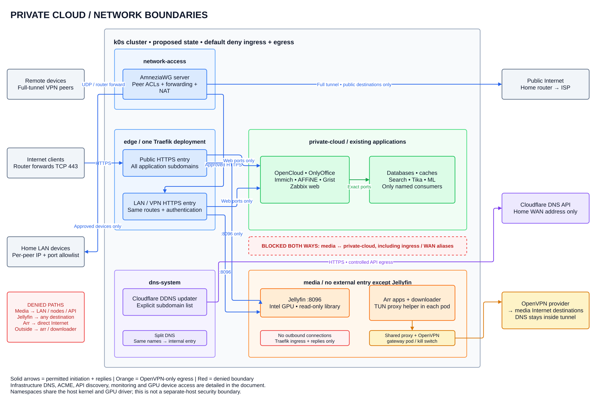

# Networking architecture and boundaries

> **Status:** implemented in repository configuration on 7 September 2026; deployment, router configuration, Cloudflare records, and external acceptance remain operator work.

The cluster uses default-deny pod networking, a restricted host firewall, Traefik for HTTPS and inbound SMTP, AmneziaWG for remote access, and AirVPN WireGuard as the guarded media applications' only Internet exit.

[Edit the draw.io source](diagrams/networking.drawio), rendered locally with draw.io Desktop 31.4.4. Arrows show permitted connection initiation; replies follow established connections.

## Trust boundaries

| Namespace / zone | Responsibility | Boundary |
| --- | --- | --- |
| `private-cloud` | Applications, OpenCloud identity, and dependencies. | Explicit application flows only. |
| `media` | Jellyfin, Sonarr, Radarr, Prowlarr, and qBittorrent. | Jellyfin accepts only Traefik ingress and exits directly for metadata; guarded apps exit through AirVPN WireGuard. |
| `edge` | Traefik HTTPS and SMTP entry plus the Grist oauth2-proxy helper. | Only approved application listeners are reachable. |
| `network-access` | AmneziaWG server, peer forwarding, and its wg-easy UI. | Configured LAN ceiling, per-peer UI firewall, and public Internet egress. |
| `dns-system` | Cloudflare DDNS updater. | DNS management has no application-data access. |
| `observability` | Alloy and OpenObserve. | Alloy ingests node logs; OpenObserve provides the authenticated HTTPS interface. |
| `kube-system` / host | CNI, DNS, device plugin, and control plane. | Infrastructure privileges stay outside application workloads. |

The k0s role requires kube-router and labels every namespace used by selector-based policies. Each namespace receives default-deny ingress and egress policies, followed by narrowly scoped exceptions.

This does not isolate workloads from a compromised node, cluster administrator, shared kernel, or shared GPU driver. Stronger isolation requires a separate VM or host.

## Host and router edge

The host installs a persistent nftables table without flushing kube-router rules. Traffic arriving on the default interface is limited to:

| Source | Host port | Purpose |
| --- | --- | --- |
| Any source | TCP `443` | Traefik HTTPS. |
| Any source | TCP `25` | Traefik SMTP proxy. |
| Any source | Configured UDP port | AmneziaWG. |
| Configured local networks | TCP `22` | SSH. |
| Configured local networks | TCP and UDP `53` | LAN DNS. |
| Configured local networks | TCP `6443` | Kubernetes API. |
| Configured local networks | TCP `31051` | Zabbix server. |

Traffic from interfaces other than loopback, the default interface, `kube-bridge`, and pod `veth` links is dropped first. All other new traffic to the host is dropped, apart from required DHCP, ICMP, loopback, established traffic, and pod-to-node traffic. Direct external forwarding to pod and service CIDRs is dropped unless it belongs to an approved marked connection.

The home router remains outside this repository. It must forward WAN TCP `443`, WAN TCP `25`, and the configured AmneziaWG UDP port to the host address. It must not forward SSH, DNS, the Kubernetes API, Zabbix, former application NodePorts, or any media service.

## LAN DNS

The `lan-dns` CoreDNS Deployment in `dns-system` is the split-DNS resolver for LAN clients, AmneziaWG peers, and pods. The router points its DNS at the host address.

| Listener | Clients | Service hostname answer |
| --- | --- | --- |
| Host TCP and UDP `53` through hostPort | Local networks and AmneziaWG peers. | Host LAN address. |
| `lan-dns` Service TCP and UDP `53` at `networking.lan_dns_cluster_ip` | k0s CoreDNS. | Traefik Service address `networking.traefik_cluster_ip`. |

- Other names are forwarded to Cloudflare over DNS-over-TLS on TCP `853`.
- The kubelet `resolvConf` names the `lan-dns` Service, so k0s CoreDNS forwards there without Corefile changes.
- `use-application-dns.net` returns NXDOMAIN, so Firefox disables its automatic DNS-over-HTTPS.
- `mask.icloud.com` and `mask-h2.icloud.com` return NXDOMAIN, so Apple devices disable iCloud Private Relay on this network.
- `resolver.arpa` returns NXDOMAIN, so DDR clients find no designated encrypted resolver.
- Chrome and Windows upgrade only known public resolvers, so they keep using the LAN address.
- Devices with a manually configured encrypted resolver bypass the canaries and need that setting disabled.
- Cluster DNS has no fallback while `lan-dns` is unavailable.

## Traefik entry

Traefik binds host TCP `443` and TCP `25` from a pod in `edge`.

- HTTPS uses exact `Host` rules from file-provider routes and Cloudflare DNS-01 certificates.
- Each routed service publishes its route as a `traefik-route-<service>` ConfigMap in `edge`.
- A projected volume merges `traefik-dynamic` and the route ConfigMaps into `/etc/traefik/dynamic`.
- Traefik watches that directory and reloads routes when kubelet updates the volume.
- Routes target backend Services by cluster DNS name and port.
- DNS-01 uses the explicit public resolvers `1.1.1.1:53` and `1.0.0.1:53`.
- Traefik may query public addresses on UDP and TCP `53` so lego can verify propagation at the authoritative nameservers.
- Traefik has no Kubernetes API access.
- No ClusterRole, Role, or binding references its ServiceAccount.
- Its ServiceAccount and pod do not mount a service-account token.
- Its NetworkPolicy has no egress to the Kubernetes API server.
- Cloudflare is the only credential Secret it receives, through an environment variable.
- Cloudflare token rotation restarts Traefik through a Secret revision annotation.
- Unknown HTTPS hosts have no matching route.
- The `strip-forwarded` file middleware removes client-supplied `Forwarded` headers on the Stalwart route.
- The Zabbix route ConfigMap is applied only after the installer sets the Zabbix administrator password.
- The dashboard is disabled.
- Application services are ClusterIP-only.
- Zabbix server TCP `31051` is the only retained NodePort.
- AmneziaWG remains a direct UDP hostPort because HTTP/TCP routing cannot proxy its UDP tunnel protocol usefully.

Public DNS resolves enabled application names to the home WAN address. LAN DNS resolves the same names to the host address in `networking.lan.address` for LAN and AmneziaWG clients, and to the Traefik Service for pods.

OpenCloud uses its configured HTTPS URL as the issuer. LAN clients and pods reach that hostname through Traefik, so the issuer matches for browsers and services.

OpenObserve is published through its configured exact HTTPS hostname. Alloy has no public route. When notifications are enabled, OpenObserve and Zabbix send alerts directly to Stalwart's internal SMTP listener on TCP `2525`.

### Pod access to the public hostname

Pods resolve the public hostname to the Traefik Service on TCP `443`. Service translation rewrites that destination to the Traefik pod on TCP `8443` before NetworkPolicy evaluation.

- OpenCloud, OnlyOffice, AFFiNE, Immich, and the oauth2-proxy helper may reach the Traefik pod on TCP `8443`.
- Grist does not reach Traefik because oauth2-proxy performs the OIDC exchange.
- AmneziaWG reaches the same pod port through hostPort translation of the host address.
- Application policies do not allow the untranslated Service or host address on TCP `443`.

## OpenCloud and Grist authentication

OpenCloud runs its built-in provider in `private-cloud` and publishes `https://<opencloud-hostname>` through Traefik. Applications and the Grist helper reach the issuer through the Traefik pod on TCP `8443` after hostPort translation.

The stateless `forward-auth` Deployment in `edge` runs oauth2-proxy v7.15.5 for Grist and uses the confidential client `grist-forward-auth`.

- Traefik applies the `strip-identity-headers` and `forward-auth` middlewares to the Grist router.
- The `forward-auth` middleware calls oauth2-proxy on TCP `4180` and passes the verified email as `X-Forwarded-User`.
- Unauthenticated browsers are redirected to OpenCloud sign-in.
- A router in the Grist route ConfigMap sends `/oauth2/` on the Grist host to oauth2-proxy without ForwardAuth.
- oauth2-proxy serves the OIDC callback at `/oauth2/callback`.
- The helper has no email or domain login allowlist.
- Grist trusts `X-Forwarded-User` on every request through `GRIST_IGNORE_SESSION=true`.
- Access is browser-only and Grist API keys do not work.
- Logout calls `/oauth2/sign_out`, which redirects to the OpenCloud end-session endpoint and then to the OpenCloud sign-in page.
- There is no `/signed-out` route on the Grist host.
- Every enabled OpenCloud user can authenticate without a separate login allowlist.

## Inbound mail and Stalwart TLS

The external inbox remains the primary Internet receiver and forwards accepted messages to the configured forwarding-domain address. The inbound path is:

`Internet sender → external inbox → forwarding-domain MX → router TCP 25 forward → Traefik hostPort 25 → raw TCP proxy with Proxy Protocol v2 → Stalwart ClusterIP TCP 25`

Port `25` is required for the forwarding service's server-to-server SMTP delivery. The repository does not expose submission ports `465` or `587`, IMAPS `993`, or a direct Stalwart HTTPS port.

JMAP, web access, and administration use the mail hostname on Traefik HTTPS TCP `443`. Stalwart relays non-local outbound messages through the configured external `inbox.eu` SMTP service.

Stalwart accepts STARTTLS on SMTP TCP `25`, trusts Proxy Protocol only from the configured pod network, and performs its own message filtering. Its HTTP listener trusts forwarded headers from any source, so a network policy limits TCP `8080` to Traefik and the Stalwart configuration Job. The host firewall therefore does not restrict SMTP to forwarding-service CIDRs.

Stalwart owns its mail certificate lifecycle. It uses a dedicated Cloudflare DNS token to complete Let's Encrypt DNS-01 challenges, install the certificate for the configured mail hostname, and renew it before expiry. Traefik neither terminates SMTP TLS nor supplies Stalwart's certificate.

The Stalwart certificate token and DDNS token are separate credentials:

- The Stalwart token proves DNS control during certificate issuance and renewal.
- The DDNS token updates the configured public A records when the WAN address changes.

The primary receiving domain's MX records remain pointed at the external inbox provider. The forwarding domain's MX record points at the Stalwart mail hostname, whose A record is maintained by DDNS.

The operator must still publish and verify SPF, DKIM, and DMARC records appropriate to the external receiving and outbound-relay design. The home address needs no PTR record because outbound mail leaves through the relay.

## Guarded media egress

The [arr stack templates](../k0s-services/arr/README.md) own the guarded applications, WireGuard gateway, and shared library storage. The media installer stage renders them separately from [Jellyfin](../k0s-services/jellyfin/README.md).

Sonarr, Radarr, Prowlarr, and qBittorrent share one AirVPN WireGuard gateway pod. Each guarded application pod has a `tun2socks` helper and no direct Internet route permitted by NetworkPolicy.

- The helper sends external TCP and UDP through the gateway's Shadowsocks listener.
- Gluetun selects an AirVPN server in `media.vpn.server_countries` from its built-in list.
- Gluetun's firewall allows only the selected server outside the tunnel.
- The gateway NetworkPolicy allows only the AirVPN WireGuard UDP port to public addresses.
- Retired servers in the bundled list fail health checks, and gluetun reconnects to another server.
- Gateway CoreDNS sends external lookups to the in-tunnel resolver `media.vpn.dns`.
- Validation requires the live peer key, endpoint port, and keepalive to match `media.vpn`.
- Cluster-local DNS is forwarded to the configured cluster DNS address.
- Guarded apps may reach only gateway DNS/proxy ports and declared media APIs.
- IPv6 is disabled until equivalent capture and filtering exist.
- VPN failure leaves guarded Internet traffic blocked.
- qBittorrent binds to `tun0`, disables UPnP, and enables anonymous mode.

Sonarr and Radarr can reach Prowlarr and qBittorrent on their API ports. Prowlarr can reach Sonarr and Radarr for synchronization. These paths use cluster networking rather than the VPN.

The arr dashboards, qBittorrent UI, peer port, discovery protocols, and UPnP are not published.

## Jellyfin

Jellyfin accepts only Traefik connections on TCP `8096`. It resolves names through cluster DNS and reaches metadata and artwork providers on TCP `443`.

Jellyfin uses the local read-only media library and one shared `gpu.intel.com/i915` allocation. Metadata and image download stay enabled; subtitle and remote-media integrations remain disabled, and users sign in with native passwords and supported clients use native Quick Connect.

## AmneziaWG

AmneziaWG runs in `network-access` as [wg-easy](https://github.com/wg-easy/wg-easy) with pod networking and one UDP hostPort. wg-easy's experimental AmneziaWG mode is forced on, so `awg-quick` starts the bundled userspace amneziawg-go through `/dev/net/tun` and the host needs no kernel module. Tunnel routes, NAT, and peer firewall rules exist only inside the pod network namespace.

The pod still has `NET_ADMIN` and `NET_RAW`, and the UI administrator can edit its interface hooks, so the UI credentials are infrastructure-trusted.

- wg-easy generates the server key and AmneziaWG obfuscation values on first start.
- The installer creates the UI administrator from Vault on first start only.
- Peers, client keys, QR codes, and per-peer firewall entries are managed in the UI.
- The UI is published at `vpn-admin.<domain>` and admits only local networks and VPN peers.
- The UI hostname stays out of public DNS and resolves through LAN DNS.
- wg-easy stores its database and configuration on the `amneziawg` dataset.

| Peer destination | Route | Enforcement |
| --- | --- | --- |
| Public Internet | Peer → AmneziaWG → host uplink → ISP. | NetworkPolicy permits public destinations; the pod applies NAT. |
| Application names | Peer → LAN DNS → Traefik TCP `443`. | Only approved HTTPS hosts route to backends. |
| Peer DNS | Peer → host address TCP/UDP `53` → `lan-dns`. | NetworkPolicy permits only the `lan-dns` pod port. |
| LAN devices | Peer → AmneziaWG → configured LAN IP and port. | NetworkPolicy caps all peers at `networking.amneziawg.lan_access`; UI firewall entries narrow single peers. |
| Other peers | No route. | A mangle rule drops `wg0` to `wg0` forwarding before wg-easy's rules. |
| Pod CIDRs, service CIDRs, and media APIs | No route. | NetworkPolicy denies the connection. |

A peer without UI firewall entries reaches everything under the NetworkPolicy ceiling. The tunnel subnet must not overlap local, pod, service, or common client networks.

## Cloudflare DDNS

A CronJob in `dns-system` discovers the current public IPv4 address and updates only the configured Cloudflare A records. It uses a token distinct from both Traefik ACME and Stalwart ACME.

Each run corrects the record content, sets `proxied` to false, and sets the TTL to 300 seconds. It refuses any discovered address that is not a public IPv4 address.

DDNS changes DNS records only. It does not configure the router, create NAT rules, bypass CGNAT, or make an ISP-blocked TCP `25` reachable.

## Allowed connection matrix

Everything omitted is denied. Each entry permits connection initiation in the stated direction and the associated replies.

| Source | Destination | Allowed scope |
| --- | --- | --- |
| WAN | Traefik | TCP `443` and TCP `25`. |
| WAN | AmneziaWG | Configured UDP port. |
| Local networks | Host | TCP `22`, `6443`, and `31051`. |
| LAN / AmneziaWG client | Traefik | TCP `443`. |
| Traefik | Approved web backends / Jellyfin | Declared backend ports only. |
| Jellyfin | metadata and artwork providers | TCP `443` after cluster DNS. |
| OIDC-enabled applications / oauth2-proxy helper | OpenCloud issuer | TCP `8443` to the Traefik pod after hostPort translation. |
| Traefik | oauth2-proxy helper | TCP `4180`. |
| Traefik | Stalwart HTTP | TCP `8080`. |
| Immich machine learning | Model download endpoints | TCP `443` to public addresses. |
| Traefik | Stalwart | TCP `25` with Proxy Protocol v2. |
| Guarded media pod | Media VPN gateway | Proxy and DNS ports only. |
| Media VPN gateway | AirVPN WireGuard servers | UDP `1637` to public addresses; gluetun pins the selected server. |
| Media integrations | Declared arr / qBittorrent APIs | Required API ports only. |
| AmneziaWG peer | Approved LAN target | Configured destination IPs and ports, narrowed per peer in the UI. |
| AmneziaWG peer | Public Internet | Full-tunnel forwarding after private-range denials. |
| Declared application | PostgreSQL and internal dependency | Service-specific ports only. |
| Stalwart | Cloudflare, Let's Encrypt, DNS, relay, and mail lookups | Required service ports only. |
| Traefik | Cloudflare and Let's Encrypt | TCP `443` to public addresses. |
| Traefik | Public DNS and authoritative nameservers | UDP and TCP `53` to public addresses. |
| DDNS | Cloudflare and IP discovery | TCP `443` to public addresses after cluster DNS. |
| OpenObserve / Zabbix | Stalwart internal SMTP listener | TCP `2525`. |

## Storage

Traefik, Jellyfin, and each enabled application have separate quota-controlled datasets under `tank/secure/backup/k0s/services` and dedicated `10Ti` PVs. Sonarr, Radarr, Prowlarr, qBittorrent, and the shared media library use `tank/secure/no-backup/k0s/services`. Jellyfin mounts the library read-only; import and download workloads receive only their required write mounts.

## Deployment acceptance

Repository implementation is not evidence of live enforcement. Before exposure:

- Confirm the router forwards only TCP `25`, TCP `443`, and the AmneziaWG UDP port.
- Verify all other host and former NodePort paths fail from WAN and LAN.
- Verify SSH, Kubernetes API, and Zabbix work only from configured local networks.
- Test every hostname from WAN, LAN, and AmneziaWG.
- Verify LAN clients resolve service hostnames to the host address and pods to the Traefik Service.
- Verify Firefox and Apple devices on the LAN fall back to the LAN resolver.
- Verify OpenCloud, Grist, AFFiNE, and Immich complete an OpenCloud OIDC login.
- Verify Grist login, the `/oauth2/callback` exchange, and logout through oauth2-proxy and the OpenCloud end-session endpoint.
- Verify Grist rejects forged `X-Forwarded-User` headers from clients.
- Validate Traefik and Stalwart certificate issuance and renewal paths against the real Let's Encrypt service.
- Confirm Immich, AFFiNE, and Jellyfin answer with the installer-claimed administrators once published.
- Send a message to the external inbox and confirm its SMTP forward reaches Stalwart.
- Confirm Proxy Protocol preserves the sender address in Stalwart.
- Verify Stalwart filtering and outbound relay behavior.
- Interrupt the AirVPN WireGuard tunnel and confirm guarded apps lose Internet and external DNS.
- Confirm Immich machine learning downloads models over TCP `443`.
- Confirm Jellyfin downloads metadata over IPv4 and cannot initiate IPv6 connections.
- Confirm Jellyfin streaming and local scanning continue during media VPN failure.
- Verify the AmneziaWG LAN ceiling, per-peer UI firewall entries, and full-tunnel Internet egress.
- Verify the AmneziaWG UI rejects clients outside local networks and the VPN.
- Verify AmneziaWG peers cannot reach the pod or service CIDRs.
- Confirm qBittorrent reports `tun0` as its bound interface.
- Verify Jellyfin transcoding uses the Intel GPU.
- Confirm OpenObserve is reachable only through its configured hostname.
- Confirm Alloy has no public route and accepts only its documented internal health path.
